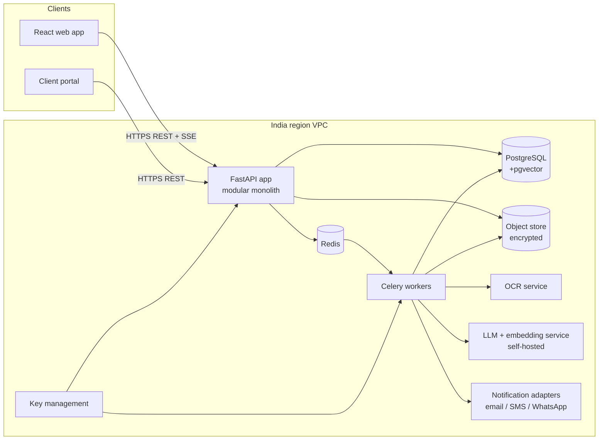
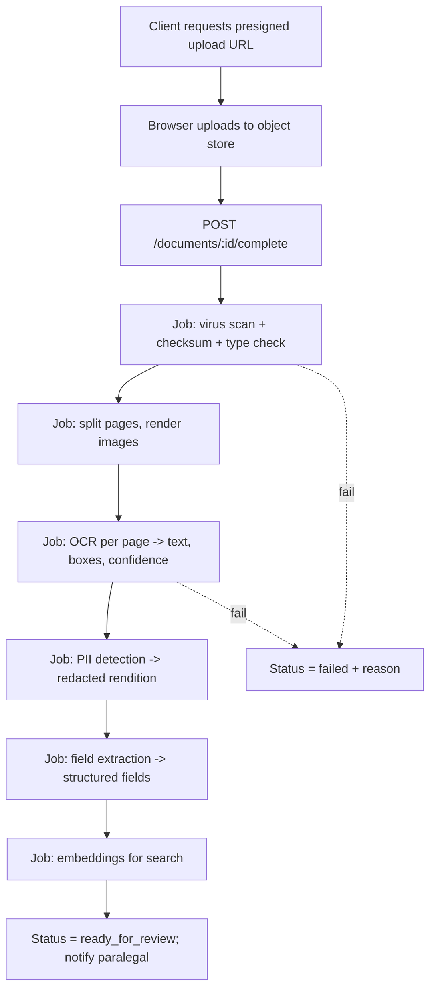

# NyaySetu - Backend Architecture & Database Design

*Phases 4 and 5. Pragmatic by design: a modular monolith, not microservices.*

---

# Part A. Backend architecture

## A1. Guiding decisions

1. **Modular monolith** (one FastAPI app, strict module boundaries). A team of 2-4 engineers cannot afford microservices. Split later only where load demands it (OCR/AI workers).
2. **PostgreSQL does most of the work:** relational data, full-text search, trigram, `pgvector` for embeddings, row-level security. One datastore fewer to run and secure.
3. **Async jobs for anything slow** (OCR, embeddings, LLM calls, exports). Never on the request thread.
4. **Tenant isolation is a first-class design rule**, enforced in code and in the database.
5. **AI runs in a separate worker process** on infrastructure inside India, with no client data sent to public AI APIs.
6. **Audit is written by the server, append-only, hash-chained.**

## A2. Technology choices

| Area | Choice | Why | Notes |
|---|---|---|---|
| API framework | **FastAPI** + Uvicorn/Gunicorn | Async, OpenAPI generated, Pydantic native | Use Python 3.12 |
| Validation | **Pydantic v2** | Typed schemas, fast | Shared validators for survey no., area, dates |
| ORM | **SQLAlchemy 2.0** (async, `asyncpg`) | Mature, typed | Use the 2.0 style only |
| Migrations | **Alembic** | Standard | One migration per PR; CI checks single head |
| Database | **PostgreSQL 16** + `pgvector`, `pg_trgm`, `pgcrypto` | See A1 | Managed service in India region, PITR on |
| Auth | **JWT access (15 min) + rotating refresh (httpOnly cookie)** | Short-lived tokens limit damage | Passwords: Argon2id. MFA: TOTP (`pyotp`), SMS/email OTP for clients |
| Cache / queue broker | **Redis** | **Yes, justified:** rate limiting, refresh-token denylist, Celery broker, short-lived OTP storage | Not used as a primary data store |
| Background jobs | **Celery** with Redis broker | **Required:** OCR and LLM jobs are long-running and need retries, scheduling (reminders), and isolation. FastAPI `BackgroundTasks` has no persistence or retry. | Separate queues: `ocr`, `ai`, `default`, `notify`; Celery Beat for reminders |
| Real-time | **Server-Sent Events (SSE)** for job progress and notifications | Simpler than WebSockets; one-way is enough | WebSockets only if collaborative editing is added later |
| File storage | **S3-compatible object store** (AWS S3 `ap-south-1`, or MinIO on-premise) | Cheap, durable, presigned uploads | SSE-KMS plus app-level envelope encryption per firm |
| Search | **Postgres FTS + pg_trgm + pgvector (hybrid)** | Enough for the first 1M passages | Re-evaluate OpenSearch only when needed |
| OCR | Open-source engine (e.g. PaddleOCR / Tesseract with Gujarati data), possibly fine-tuned; pluggable adapter | Self-hosted, no data leaves | Benchmark on your own documents before choosing |
| LLM | Self-hosted open-weight model served via vLLM (or similar), behind an internal adapter interface | Meets "no external AI API" promise | Pick the model after Gujarati evaluation (doc 05) |
| Embeddings | Self-hosted multilingual embedding model | Gujarati support needed | Evaluate on real queries |
| PDF/DOCX export | `python-docx` + HTML-to-PDF (WeasyPrint/Chromium) with Noto Sans Gujarati/Devanagari embedded | Court-format output | Golden-file tests |
| Antivirus | ClamAV | Scan uploads | Async step before processing |
| Email / SMS / WhatsApp | Provider adapter (SES/SMTP; SMS and WhatsApp Business API provider) | Swappable | Templates stored per locale |
| Observability | `structlog` JSON logs, OpenTelemetry, Prometheus/Grafana, Sentry (scrub PII) | Debuggable | Request ID on every log line |
| Containers | **Docker** + Compose for dev; Kubernetes only if needed later; start with ECS/Fargate or a single VM pair | Reproducibility | CI builds images |
| Rate limiting | `slowapi`/custom with Redis | Abuse prevention | Per IP, per user, per firm |
| Testing | `pytest`, `pytest-asyncio`, `httpx`, `testcontainers`, `factory-boy`, Schemathesis | Realistic tests | See doc 04 test checklist |

**Deliberately not used:** microservices, GraphQL, Kafka, a separate vector database, blockchain (the hash chain gives tamper evidence without it), external AI APIs for client documents.

## A3. System context



## A4. Module boundaries (inside the monolith)

```
app/
  core/          config, security, db, logging, errors, pagination, rate limit
  modules/
    auth/        login, MFA, tokens, invitations, sessions
    firms/       firms, memberships, roles, settings, retention
    matters/     matters, parties, parcels, stages, team
    documents/   upload, storage, versions, renditions, redaction
    extraction/  OCR jobs, fields, review queue
    title/       mutation entries, encumbrances, chain, flags, reports
    research/    corpus ingestion, search, judgments, saved items
    drafting/    templates, drafts, versions, grounds, evidence, review, export
    citations/   verifier
    deadlines/   limitation rules, holidays, deadlines, hearings, reminders
    audit/       events, hash chain, privacy receipts
    notifications/ in-app, email, sms, whatsapp
    portal/      client accounts and published updates
    ai/          model adapters, prompts, guardrails, run logs
    admin/       usage, exports, data requests
  workers/       celery app, tasks per module
  main.py
```

Rules: a module may call another module only through its `service.py` interface. No cross-module table writes. Each module owns its tables, schemas, routers, services, and tests.

Typical module layout: `router.py`, `schemas.py`, `models.py`, `service.py`, `repository.py`, `permissions.py`, `tasks.py`, `tests/`.

## A5. Multi-tenancy and authorisation

| Layer | Mechanism |
|---|---|
| Identity | `users` are global; `firm_memberships` link user to firm and role |
| Token | Access token carries `sub`, `firm_id`, `role`, `session_id`, `exp`. Role is re-checked against DB for sensitive actions |
| Request context | A dependency loads `{user, firm, role, permissions}` and sets Postgres session variable `app.firm_id` and `app.user_id` |
| Database | **Row-Level Security** on every tenant table: `USING (firm_id = current_setting('app.firm_id')::uuid)` as defence in depth |
| Matter access | `matter_members` table; helper `require_matter_access(matter_id, capability)` |
| Capabilities | Permission strings (e.g. `draft.approve`, `document.upload`) mapped from roles; returned in `/auth/me` for the UI |
| Not found vs forbidden | Return 404 for resources outside the caller's scope |
| Clients | Separate principal type `client` with access only to `portal_updates` for their own matters |

## A6. Authentication flows

**Login:** `POST /auth/login` (email + password) -> if valid and MFA enrolled -> returns `mfa_required` + short-lived challenge ID -> `POST /auth/mfa/verify` (6-digit code) -> sets refresh cookie (httpOnly, Secure, SameSite=Strict, path `/api/v1/auth`) and returns access token in the body (kept in memory by the SPA).

**Refresh:** `POST /auth/refresh` rotates the refresh token; reuse of an old token revokes the whole session family and alerts the user.

**Logout:** revokes the current session; `POST /auth/logout-all` revokes all.

**Client login:** mobile number -> OTP (5 min expiry, max 5 attempts, resend cooldown) -> access token with `principal=client`.

**CSRF:** refresh endpoint requires a CSRF header token; access tokens are bearer headers so other endpoints are not cookie-authenticated.

**Hardening:** Argon2id; lockout (5 fails/10 min); per-IP and per-account rate limits; new-device email; password change revokes sessions; invitation tokens single-use, hashed in DB.

## A7. Encryption and key management

- TLS everywhere; HSTS.
- Disk and object encryption via the cloud KMS.
- **Envelope encryption:** each firm has a data-encryption key (DEK) wrapped by a KMS key; documents and sensitive columns (party names, Aadhaar-like identifiers if stored) are encrypted with the firm DEK. Key IDs stored on rows so keys can rotate.
- Search needs plaintext, so the searchable index of matter documents lives in the same encrypted database; restrict DB access, and keep PII redaction before any AI step.
- Be accurate in marketing: say "encrypted at rest with per-firm keys" only when this is implemented. Avoid "air-gapped" unless the AI workers truly have no external network path.

## A8. Document processing pipeline



Each step is idempotent, retried with backoff (max 3), writes status to `processing_jobs`, and emits an audit event. Progress is pushed over SSE.

## A9. AI boundary

All AI calls go through `modules/ai` which: (1) redacts PII first, (2) builds prompts from templates, (3) calls the self-hosted model adapter, (4) validates output against a schema, (5) stores an `ai_runs` record (model, version, prompt hash, input document IDs, tokens, latency, status; no raw text by default), (6) returns results flagged `ai_generated=true`. See doc 05.

## A10. Cross-cutting conventions

| Topic | Decision |
|---|---|
| IDs | UUIDv7 (time-ordered) for all primary keys |
| Time | `timestamptz` in UTC; display in IST; deadlines also store the date in IST as `date` |
| Money / area | Money `numeric(14,2)`; area stored as raw string + integer total sq.m |
| Soft delete | `deleted_at`, `deleted_by` on business tables; unique indexes use `WHERE deleted_at IS NULL`; hard delete only through retention jobs |
| Versioning | Append-only `*_versions` tables for drafts, templates, corrected fields, limitation rules |
| Optimistic concurrency | `row_version int` on drafts and fields; `If-Match` / version in payload |
| Idempotency | `Idempotency-Key` header on POSTs that create resources or send notifications |
| Config | 12-factor, env variables, validated with Pydantic Settings |
| Logging | JSON, request ID, user ID, firm ID, no document text, no PII |
| Environments | local, staging (synthetic data only), production |

## A11. Deployment shape (start simple)

- Containers: `api`, `worker-ocr`, `worker-ai` (GPU node, scaled to zero if possible), `worker-default`, `beat`, `redis`, `postgres` (managed), `object store` (managed).
- CI: lint, type-check (mypy), tests, migration check, container build, vulnerability scan.
- CD: staging auto-deploy; production manual approval; Alembic migrations run before the app rolls.
- Backups: daily snapshots + PITR; quarterly restore drill; object-store versioning on.

---

# Part B. Database design

## B1. Conventions

- Every tenant table has `firm_id uuid NOT NULL` + index + RLS policy.
- Timestamps: `created_at`, `updated_at`; business tables add `deleted_at`.
- `text` with `CHECK` or Postgres `ENUM` types for statuses (prefer lookup `CHECK` constraints for easier migration).
- Foreign keys everywhere; `ON DELETE RESTRICT` by default; cascades only for pure child rows.

## B2. Table catalogue and purpose

### Identity and tenancy
| Table | Purpose | Key columns / notes |
|---|---|---|
| `firms` | Tenant | name, status, region, settings jsonb, retention_default_days, key_id |
| `users` | Global accounts | email (citext, unique), password_hash, mfa_enabled, locale, status |
| `firm_memberships` | User in firm with role | firm_id, user_id, role, all_matters_access bool, status; unique(firm_id,user_id) |
| `advocate_profiles` | Bar details | user_id, enrolment_no, state_code, verified_by, verified_at |
| `invitations` | Pending invites | firm_id, email, role, token_hash, expires_at, accepted_at |
| `sessions` | Refresh-token families | user_id, family_id, token_hash, device, ip, expires_at, revoked_at |
| `mfa_credentials` | TOTP secrets (encrypted) | user_id, type, secret_enc, confirmed_at |
| `login_attempts` | Lockout and security analytics | email_hash, ip, success, at |
| `client_accounts` | External client principals | firm_id, party_id, mobile, locale, status |

### Matters
| Table | Purpose | Notes |
|---|---|---|
| `parties` | People/organisations (clients, opposite parties) | firm_id, type, name_enc, mobile_enc, address_enc; search by hashed/normalised name for conflict checks |
| `matters` | Core case | firm_id, matter_no, title, forum_id, statute_id, stage, status, opened_at, archived_at |
| `matter_members` | Matter team and access | matter_id, user_id, matter_role (lead/member) |
| `matter_parties` | Parties in a matter | matter_id, party_id, side (our client/opposite/other) |
| `matter_stages` | Stage history | matter_id, from_stage, to_stage, by, at, note |
| `forums` | Master list (Mamlatdar, Prant Officer, Collector, SSRD, GRT, High Court...) | global, versioned |
| `statutes`, `statute_sections` | Master statutes and sections with effective dates and source URL | global, versioned |
| `land_parcels` | Survey-number records on a matter | matter_id, village, taluka, district, survey_no, sub_no, khata_no, area_raw, area_sqm |

### Documents and extraction
| Table | Purpose | Notes |
|---|---|---|
| `documents` | Logical document | matter_id, doc_type, source, certified bool, title, current_version_id |
| `document_versions` | Immutable file versions | storage_key, sha256, size, mime, page_count, uploaded_by, scan_status |
| `document_pages` | Page-level assets | version_id, page_no, image_key, redacted_image_key, ocr_text_tsv |
| `ocr_results` | OCR output per page | page_id, engine, engine_version, text, boxes jsonb, mean_confidence |
| `processing_jobs` | Pipeline status | document_version_id, step, status, attempts, error_code, started/finished |
| `extracted_fields` | Structured fields | document_version_id, parcel_id, field_key, value_raw, value_norm, confidence, page_id, bbox jsonb, status (auto/needs_review/verified/rejected), verified_by |
| `extracted_field_versions` | Correction history | field_id, value, changed_by, reason, at |
| `pii_findings` | Detected PII spans | page_id, kind, bbox, redacted bool |

### Title chain
| Table | Purpose | Notes |
|---|---|---|
| `title_events` | Mutation entries, sales, partitions, mortgages, discharges | parcel_id, event_type, entry_no, event_date, certification_date, parties jsonb, area_sqm, source_page_id, status |
| `title_event_links` | Parent/child links (graph, not just list) | parent_event_id, child_event_id |
| `encumbrances` | Charges and their discharge | parcel_id, kind, holder, amount, created_event_id, discharged_event_id |
| `title_flags` | Rule-generated issues | parcel_id, rule_code, severity, message, event_ids, resolved_by, resolution_note |
| `title_reports` | Generated reports | parcel_id/matter_id, version, status, signed_off_by, file_key |
| `matter_notes` | Advocate-authored analysis (privileged) | matter_id, ref_type, ref_id, body, client_visible=false |

### Research
| Table | Purpose | Notes |
|---|---|---|
| `legal_sources` | Judgments and orders | court_id, forum_id, citation, case_name, decided_on, bench, language, source_licence, file_key, status |
| `source_passages` | Paragraph-level text | source_id, para_no, text, tsv, embedding vector(dim), language |
| `citation_aliases` | Alternate citation strings | source_id, alias (for verifier matching) |
| `source_treatments` | Followed/distinguished/overruled | source_id, by_source_id, kind, note, added_by |
| `matter_research_items` | Saved results | matter_id, source_id, passage_id, note, saved_by |
| `ingestion_batches` | Corpus loads | provenance, licence, count, checksum, loaded_by |

### Drafting
| Table | Purpose | Notes |
|---|---|---|
| `templates` | Template identity | firm_id (null = system), type, forum_id, statute_id, status |
| `template_versions` | Immutable versions | template_id, version, body jsonb (structure + variables), language, approved_by |
| `drafts` | Draft identity | matter_id, template_version_id, title, status, current_version_id, lead_author |
| `draft_versions` | Immutable versions | draft_id, version_no, content jsonb (grounds, prayer, header), language, created_by, content_hash |
| `draft_grounds` | Optional normalised grounds for querying | draft_version_id, ordinal, text, source (user/ai/template) |
| `draft_references` | Evidence, statute, precedent links | draft_version_id, ground_ordinal, ref_type, document_page_id / section_id / passage_id, bbox, label |
| `citation_checks` | Verifier results | draft_version_id, reference_id, status, matched_source_id, checked_at |
| `draft_reviews` | Review workflow | draft_version_id, reviewer_id, state, comment |
| `draft_comments` | Inline comments | draft_version_id, anchor, author, body, resolved |
| `draft_approvals` | Approval records | draft_version_id, approver_id, approved_at, content_hash |
| `draft_translations` | Language versions | draft_version_id, language, content jsonb, status (machine/reviewed), reviewed_by |
| `exports` | Generated files | draft_version_id, format, watermarked bool, file_key, by, at |

### Deadlines and hearings
| Table | Purpose | Notes |
|---|---|---|
| `limitation_rules` | Advocate-reviewed rules | act, section, forum_id, days, count_from, exclusions jsonb, source_ref, version, reviewed_by, effective_from/to |
| `holidays` | Court/state holidays | calendar_id, date, name, scope |
| `deadlines` | Matter deadlines | matter_id, rule_id, rule_version, trigger_date, due_date, calculation jsonb, owner_id, status |
| `hearings` | Matter hearings | matter_id, forum_id, hearing_at, board_item, stage, outcome, source (manual/import) |
| `reminders` | Scheduled reminders | target_type/id, remind_at, channel, status |

### Audit, privacy, notifications
| Table | Purpose | Notes |
|---|---|---|
| `audit_events` | **Append-only, hash-chained** | firm_id, seq, at, actor_id, actor_role, action, resource_type, resource_id, matter_id, ip, user_agent, metadata jsonb, prev_hash, hash |
| `audit_anchors` | Periodic hash anchors | firm_id, up_to_seq, hash, anchored_at (optionally to external timestamp service) |
| `privacy_receipts` | Generated receipts | matter_id, period, file_key, audit_anchor_id |
| `ai_runs` | Every AI call | firm_id, task, model, model_version, input_refs, prompt_hash, status, tokens, latency, by |
| `notifications` | In-app items | user_id, kind, payload, read_at |
| `notification_deliveries` | Email/SMS/WA | notification_id, channel, provider_id, status |
| `retention_policies`, `legal_holds` | Retention control | firm_id/matter_id, days, reason, set_by |
| `data_requests` | Export/deletion requests | firm_id, requester, kind, status |
| `portal_updates` | Client-visible updates | matter_id, locale, title, body, published_by, published_at |
| `feedback` | Search/AI feedback | user_id, target, rating, comment |

Total: about 60 tables. MVP needs roughly 40 of them; client portal, translations, treatments, legal holds can wait.

## B3. Core DDL (illustrative; complete the rest the same way)

```sql
CREATE EXTENSION IF NOT EXISTS pgcrypto;
CREATE EXTENSION IF NOT EXISTS citext;
CREATE EXTENSION IF NOT EXISTS pg_trgm;
CREATE EXTENSION IF NOT EXISTS vector;

CREATE TABLE firms (
  id uuid PRIMARY KEY,
  name text NOT NULL,
  status text NOT NULL CHECK (status IN ('active','suspended','closed')),
  region text NOT NULL DEFAULT 'ap-south-1',
  kms_key_id text NOT NULL,
  retention_default_days int,
  settings jsonb NOT NULL DEFAULT '{}',
  created_at timestamptz NOT NULL DEFAULT now(),
  updated_at timestamptz NOT NULL DEFAULT now()
);

CREATE TABLE users (
  id uuid PRIMARY KEY,
  email citext NOT NULL UNIQUE,
  password_hash text NOT NULL,
  full_name text NOT NULL,
  locale text NOT NULL DEFAULT 'en' CHECK (locale IN ('en','gu','hi')),
  mfa_enabled boolean NOT NULL DEFAULT false,
  status text NOT NULL DEFAULT 'active' CHECK (status IN ('invited','active','locked','disabled')),
  created_at timestamptz NOT NULL DEFAULT now(),
  updated_at timestamptz NOT NULL DEFAULT now()
);

CREATE TABLE firm_memberships (
  id uuid PRIMARY KEY,
  firm_id uuid NOT NULL REFERENCES firms(id),
  user_id uuid NOT NULL REFERENCES users(id),
  role text NOT NULL CHECK (role IN ('admin','partner','associate','paralegal','researcher')),
  all_matters_access boolean NOT NULL DEFAULT false,
  status text NOT NULL DEFAULT 'active' CHECK (status IN ('active','suspended')),
  created_at timestamptz NOT NULL DEFAULT now(),
  UNIQUE (firm_id, user_id)
);

CREATE TABLE matters (
  id uuid PRIMARY KEY,
  firm_id uuid NOT NULL REFERENCES firms(id),
  matter_no text NOT NULL,
  title text NOT NULL,
  forum_id uuid REFERENCES forums(id),
  statute_id uuid REFERENCES statutes(id),
  stage text NOT NULL CHECK (stage IN ('intake','ingestion','title','drafting','review','filed','closed')),
  status text NOT NULL DEFAULT 'open' CHECK (status IN ('open','archived')),
  opened_at timestamptz NOT NULL DEFAULT now(),
  created_by uuid NOT NULL REFERENCES users(id),
  deleted_at timestamptz,
  created_at timestamptz NOT NULL DEFAULT now(),
  updated_at timestamptz NOT NULL DEFAULT now()
);
CREATE UNIQUE INDEX matters_no_uq ON matters (firm_id, matter_no) WHERE deleted_at IS NULL;
CREATE INDEX matters_firm_stage_idx ON matters (firm_id, stage, status);

CREATE TABLE matter_members (
  matter_id uuid NOT NULL REFERENCES matters(id) ON DELETE CASCADE,
  user_id uuid NOT NULL REFERENCES users(id),
  firm_id uuid NOT NULL REFERENCES firms(id),
  matter_role text NOT NULL DEFAULT 'member' CHECK (matter_role IN ('lead','member')),
  PRIMARY KEY (matter_id, user_id)
);

CREATE TABLE document_versions (
  id uuid PRIMARY KEY,
  firm_id uuid NOT NULL REFERENCES firms(id),
  document_id uuid NOT NULL REFERENCES documents(id),
  version_no int NOT NULL,
  storage_key text NOT NULL,
  sha256 bytea NOT NULL,
  size_bytes bigint NOT NULL CHECK (size_bytes > 0),
  mime text NOT NULL,
  page_count int,
  scan_status text NOT NULL DEFAULT 'pending' CHECK (scan_status IN ('pending','clean','infected','failed')),
  uploaded_by uuid NOT NULL REFERENCES users(id),
  created_at timestamptz NOT NULL DEFAULT now(),
  UNIQUE (document_id, version_no)
);
CREATE INDEX docver_sha_idx ON document_versions (firm_id, sha256);   -- duplicate detection

CREATE TABLE extracted_fields (
  id uuid PRIMARY KEY,
  firm_id uuid NOT NULL REFERENCES firms(id),
  document_version_id uuid NOT NULL REFERENCES document_versions(id),
  parcel_id uuid REFERENCES land_parcels(id),
  field_key text NOT NULL,
  value_raw text,
  value_norm text,
  confidence numeric(4,3) CHECK (confidence BETWEEN 0 AND 1),
  page_id uuid REFERENCES document_pages(id),
  bbox jsonb,
  status text NOT NULL DEFAULT 'auto' CHECK (status IN ('auto','needs_review','verified','rejected')),
  verified_by uuid REFERENCES users(id),
  verified_at timestamptz,
  row_version int NOT NULL DEFAULT 1,
  UNIQUE (document_version_id, parcel_id, field_key)
);
CREATE INDEX fields_review_idx ON extracted_fields (firm_id, status) WHERE status = 'needs_review';

CREATE TABLE draft_versions (
  id uuid PRIMARY KEY,
  firm_id uuid NOT NULL REFERENCES firms(id),
  draft_id uuid NOT NULL REFERENCES drafts(id),
  version_no int NOT NULL,
  language text NOT NULL CHECK (language IN ('en','gu','hi')),
  content jsonb NOT NULL,
  content_hash bytea NOT NULL,
  created_by uuid NOT NULL REFERENCES users(id),
  created_at timestamptz NOT NULL DEFAULT now(),
  UNIQUE (draft_id, version_no)
);

CREATE TABLE draft_references (
  id uuid PRIMARY KEY,
  firm_id uuid NOT NULL REFERENCES firms(id),
  draft_version_id uuid NOT NULL REFERENCES draft_versions(id) ON DELETE CASCADE,
  ground_ordinal int NOT NULL,
  ref_type text NOT NULL CHECK (ref_type IN ('document','statute','precedent','external')),
  document_page_id uuid REFERENCES document_pages(id),
  statute_section_id uuid REFERENCES statute_sections(id),
  passage_id uuid REFERENCES source_passages(id),
  bbox jsonb,
  label text NOT NULL,
  CHECK (
    (ref_type='document'  AND document_page_id IS NOT NULL) OR
    (ref_type='statute'   AND statute_section_id IS NOT NULL) OR
    (ref_type='precedent' AND passage_id IS NOT NULL) OR
    (ref_type='external')
  )
);

CREATE TABLE limitation_rules (
  id uuid PRIMARY KEY,
  act text NOT NULL,
  section text NOT NULL,
  forum_id uuid REFERENCES forums(id),
  title text NOT NULL,
  days int NOT NULL CHECK (days > 0),
  count_from text NOT NULL,                 -- e.g. 'date_of_order' | 'date_of_service'
  exclusions jsonb NOT NULL DEFAULT '[]',   -- e.g. copy time, holidays
  source_ref text NOT NULL,
  version int NOT NULL,
  reviewed_by text NOT NULL,                -- named advocate
  reviewed_at date NOT NULL,
  effective_from date NOT NULL,
  effective_to date,
  UNIQUE (act, section, forum_id, version)
);

CREATE TABLE audit_events (
  firm_id uuid NOT NULL REFERENCES firms(id),
  seq bigint NOT NULL,
  at timestamptz NOT NULL DEFAULT now(),
  actor_id uuid,
  actor_role text,
  action text NOT NULL,
  resource_type text,
  resource_id uuid,
  matter_id uuid,
  ip inet,
  user_agent text,
  metadata jsonb NOT NULL DEFAULT '{}',
  prev_hash bytea NOT NULL,
  hash bytea NOT NULL,
  PRIMARY KEY (firm_id, seq)
);
CREATE INDEX audit_matter_idx ON audit_events (firm_id, matter_id, at DESC);
CREATE INDEX audit_actor_idx  ON audit_events (firm_id, actor_id, at DESC);
-- Append-only: revoke UPDATE/DELETE from the app role, plus a trigger that raises on UPDATE/DELETE.
-- hash = SHA256(prev_hash || canonical_json(row fields)); a verifier job re-computes the chain nightly.

CREATE TABLE source_passages (
  id uuid PRIMARY KEY,
  source_id uuid NOT NULL REFERENCES legal_sources(id),
  para_no int,
  language text NOT NULL,
  text text NOT NULL,
  tsv tsvector GENERATED ALWAYS AS (to_tsvector('simple', text)) STORED,
  embedding vector(1024)
);
CREATE INDEX passages_tsv_idx  ON source_passages USING gin (tsv);
CREATE INDEX passages_trgm_idx ON source_passages USING gin (text gin_trgm_ops);
CREATE INDEX passages_vec_idx  ON source_passages USING hnsw (embedding vector_cosine_ops);
```

*Gujarati and Hindi have no built-in Postgres stemmers; `'simple'` config plus trigram plus vectors is the practical baseline. Normalise digits and Unicode before indexing.*

## B4. Row-level security pattern

```sql
ALTER TABLE matters ENABLE ROW LEVEL SECURITY;
CREATE POLICY firm_isolation ON matters
  USING (firm_id = current_setting('app.firm_id', true)::uuid);
-- Application sets: SET LOCAL app.firm_id = '<uuid>'; per request transaction.
-- App DB role must NOT be a superuser and must NOT have BYPASSRLS.
```

## B5. Index strategy

| Query | Index |
|---|---|
| Matter list by firm, stage, status | `(firm_id, stage, status)` and `(firm_id, created_at DESC)` |
| My matters | `matter_members (user_id)` |
| Matter search by number/title | trigram on `title`; unique `(firm_id, matter_no)` |
| Review queue | partial index on `extracted_fields WHERE status='needs_review'` |
| Duplicate upload | `(firm_id, sha256)` |
| Deadlines dashboard | `(firm_id, due_date) WHERE status='open'` |
| Hearings calendar | `(firm_id, hearing_at)` |
| Audit by matter/actor | as DDL above |
| Notifications | `(user_id, read_at NULLS FIRST, created_at DESC)` |
| Judgment search | GIN on `tsv`, trigram, HNSW on `embedding`; filters on `legal_sources (court_id, decided_on)` |

## B6. Cascading and deletion rules

| Relationship | Rule |
|---|---|
| firm -> anything | `RESTRICT`; firm offboarding is a controlled job, not a cascade |
| matter -> members, parties, stages | `CASCADE` (pure child rows) |
| matter -> documents, drafts, audit | `RESTRICT`; matters are archived, not deleted |
| document -> versions -> pages -> OCR | Children cascade only within the retention job |
| draft_versions -> references | `CASCADE` |
| audit_events | Never deleted; on firm closure, exported then sealed |
| legal_sources | Soft delete (`status='withdrawn'`), keep citation aliases |

## B7. Soft delete, versioning and audit strategy

- **Soft delete:** `deleted_at/deleted_by` on matters, parties, documents, drafts, templates. Default queries filter `deleted_at IS NULL`. Retention job performs hard deletion after the policy period unless a legal hold exists, writing an audit event first.
- **Versioning:** drafts, templates, limitation rules, extracted-field corrections, title reports are append-only versions; "current" pointer stored on the parent.
- **Audit:** every state-changing request and every read of sensitive resources (document view, PII reveal, export, audit view) writes one `audit_events` row in the same transaction as the change. A nightly job verifies the hash chain and writes `audit_anchors`; anchor hashes can be emailed to the firm or sent to an external timestamping service for stronger evidence.
- **Change history for business fields** (e.g. matter edits): generic `change_log` (resource, field, old, new, by, at) or rely on audit metadata diffs.

## B8. Data sizing notes

| Item | Estimate |
|---|---|
| Document pages | 1M pages/year; store images in object storage, not in Postgres |
| Passages | 1M judgments x ~100 passages = 100M rows worst case; start with a scoped Gujarat revenue corpus (tens of thousands of judgments) and partition `source_passages` by court/year if it grows |
| Embeddings | 1024-dim float4 ~ 4 KB/row; halfvec or quantisation if large |
| Audit | ~100-500 events per matter; partition by firm/month later |

## B9. Seed and reference data

Forums, statutes and sections, limitation rules, holiday calendars, templates, and one demo firm with the canonical matter 809 (consistent data) loaded by versioned seed scripts. Reference data tables are global (no `firm_id`) except firm-specific templates.
